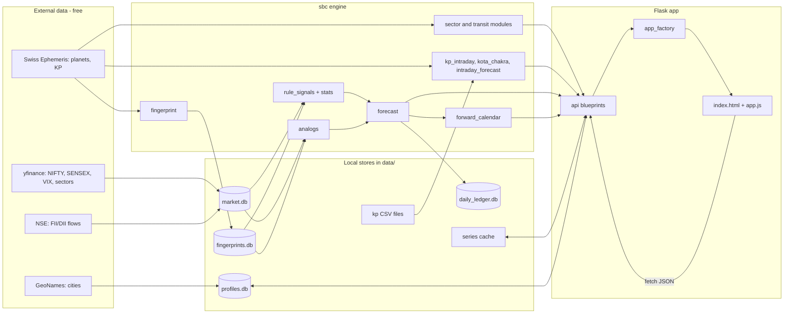
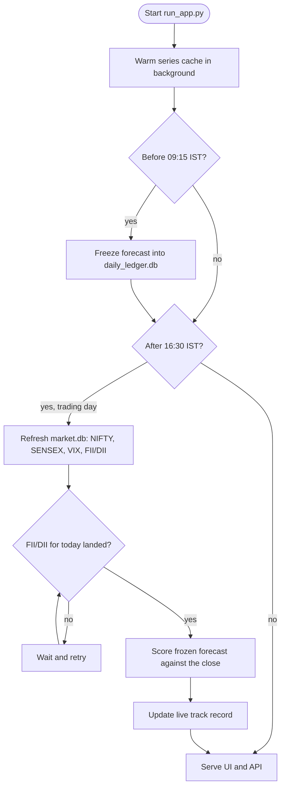
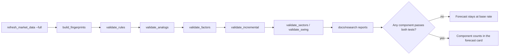

# SBC Tool: Project Overview

Review date: 2026-10-10 · Branch: `backlog-followups` (after `7e72bc2`)

This document describes what the project is, what it is for, how data moves through it,
and what runs when. It is a snapshot of the code and docs. The live status is in
`docs/BACKLOG_REVIEW_2026-10-01.md`, `docs/BACKLOG_MONTHLY_PROJECTION_2026-10-05.md`
and `docs/GAP_ANALYSIS_PREDICTION_ENGINE_2026-10-03.md`.

---

## 1. Project description

**Sarvatobhadra Chakra (SBC) Tool** is a Flask web application. It computes Vedic
astrological indicators (the 81-cell Sarvatobhadra Chakra, nakshatras, tithis, Bhadra,
planetary aspects, KP sub-lords) with Swiss Ephemeris precision. It displays them
against Indian market data: NIFTY 50, SENSEX, India VIX, sector stocks, gold and silver.

It is a single-page workstation. One `templates/index.html` shell holds tabbed panels,
driven by `static/app.js`, backed by about 60 JSON endpoints.

**Status:** research tool, not investment advice. Every astro signal tested out of sample
against NIFTY has so far shown no edge (see section 2 and the README banner).

### Scale at a glance

| Area | Size / count |
|---|---|
| Core engine (`sbc/`) | About 70 modules, plus `sbc/api/` |
| Blueprints (`sbc/api/blueprints/`) | 12: overview, chart, timing, sectors, signals, kp, balance, chakra, forecast, research, profile, integrations |
| Tests (`tests/`) | 50+ pytest modules; CI runs ruff and mypy as blocking checks |
| Data stores | `data/market.db`, `data/fingerprints.db` (1990–2035), `data/daily_ledger.db`, `data/profiles.db`, GeoNames city table |
| Validation reports | `docs/research/*` (rules, analogs, factors, incremental, sectors, swing) |

### Technology

- **Backend:** Python 3.11+ (Docker image 3.12), Flask 3, pyswisseph, pandas, numpy,
  yfinance (free market data), timezonefinder, python-dateutil.
- **Frontend:** vanilla JavaScript, no build step. Lightweight Charts and Chart.js for
  price and KP paths, Plotly for the intraday panel. JavaScript moved out of
  `index.html` into `static/` (B-17).
- **Deployment:** gunicorn `app:app`, Docker Compose with nginx in front, `/healthz` for
  the container health check. Non-GET requests need `SBC_API_TOKEN` unless they come
  from localhost.

---

## 2. Objective

**Primary objective:** build a NIFTY forecast that is judged honestly. Astro signals are
the hypotheses. The product is a measured answer to "does this beat the base rate?"

Working decisions (from the 2026-10-03 gap analysis):

1. NIFTY first, daily horizon, tiered similarity, free data only.
2. A forecast probability stays at the historical base rate until a component passes both
   the permutation test and the incremental test against market controls (VIX, trend,
   volatility, calendar).
3. Hypotheses are pre-registered before they are judged. A rule is not flipped after its
   result is seen.
4. A live ledger freezes each session's forecast before the open and scores it after the
   close, so the track record grows without hindsight.

**Current result:** 0 of 60 rule × horizon tests pass q < 0.05 (2007-09 to 2026-10). The
SBC vedha net shows no edge at any horizon. Analogs and sector scenarios are still being
graded.

**Secondary objectives (product features):**

- One place to see the chakra, the day's Bhadra and tithi windows, Rahu–Ketu trap days,
  yoga alerts and sector signals.
- A reproducible engine. The fingerprint and series caches are versioned by the code that
  built them. A test fails when a route has neither a UI caller nor a place on the API-only list.

### Backlog health

| Item | Status |
|---|---|
| Sprints 1–4: correctness, KP data regenerated from ephemeris, holiday calendar, app factory, UI smoke tests | Done |
| Prediction engine phases 0–2: market store, fingerprints, stats harness | Done |
| Phase 3 (analogs) and phase 4 (combined forecast) | In progress; graded by the same harness |
| Monthly projection backlog (B-40 freeze, B-42 stations, B-44 latitude, B-45 charts) | Committed |
| Latest commit `7e72bc2`: muhurta, aspect table, trade journal, third-party rebuild | Pushed |

---

## 3. Users and use cases

| User | Need |
|---|---|
| Researcher / trader (primary) | See what the rules say for a date, and whether they have ever worked |
| Trader reviewing a day | Executive Overview forecast card, trading signals, Rahu–Ketu trap calendar |
| Sector or swing trader | Sector heatmap, bullion and transit vedha, swing entries with Gann/Fibonacci exits |
| Reviewer of the research | Validation reports, live ledger record, forward calendar |
| TradingView user | `/api/engine/aspect_windows?format=tv` for the Pine indicator in `tools/tradingview/` |

---

## 4. Architecture



### Module map

| Layer | Modules | Role |
|---|---|---|
| Astro core | `chakra`, `planets`, `nakshatra`, `bhadra`, `muhurta`, `aspect_table`, `helio_aspects`, `stations`, `transits` | Positions, aspects, nakshatra and tithi, Bhadra |
| Chakra signals | `prediction`, `sector_signals`, `transit_vedha`, `bullion_vedha`, `fmcg_signals`, `tourism_signals`, `chemical_signals`, `alcohol_signals`, `lunar_forecast`, `monthly_heatmap`, `cgsp_framework` | Vedha and sector scenarios |
| KP | `kp_ephemeris`, `kp_layers`, `kp_intraday`, `kp_docx`, `kota_chakra`, `navamsa_pipeline/` | Sub-lords, intraday trend changes, Kota workbook |
| Research | `fingerprint`, `factors`, `stats`, `rule_validation`, `analog_validation`, `factor_validation`, `incremental`, `sector_validation`, `swing_validation`, `research_reports` | Tests against market controls |
| Forecast | `forecast`, `forecast_ledger`, `daily_ledger`, `forward_calendar`, `swing_model`, `gann`, `gann_zones`, `expiry_range` | Session forecast, freeze and score, calendar |
| Market data | `market_store`, `market_ohlc`, `market_data`, `market_events`, `market_features`, `market_holidays`, `data_freshness`, `series_cache`, `cities` | Stores, holidays, freshness badges |
| Web | `app_factory`, `app_boot`, `api/engine_bp`, `api/errors`, `api/blueprints/*` | Routes, write gate, rate limit, error handling |

---

## 5. Workflow

### 5.1 Daily (trading day)



### 5.2 Research cycle (manual)



### 5.3 Request path (UI)

```mermaid
sequenceDiagram
    participant U as Browser (app.js)
    participant N as nginx (optional)
    participant F as Flask app_factory
    participant B as Blueprint
    participant E as sbc engine
    participant D as data stores and cache

    U->>N: GET /api/...
    N->>F: proxy
    F->>F: rate limit, write gate (GET passes)
    F->>B: route
    B->>D: cache lookup (versioned by engine_version)
    alt cache hit
        D-->>B: rows
    else miss
        B->>E: compute
        E->>D: read market, fingerprint
        E-->>B: payload
        B->>D: store row
    end
    B-->>U: JSON with freshness stamp
    U->>U: render; amber badge if data is one session behind
```

### 5.4 Write path

Every POST, PUT and DELETE (profiles, habits, webhook, KP sample) is accepted from
localhost. Remote writes need an `X-API-Token` header equal to `SBC_API_TOKEN`.

---

## 6. Calendar: what runs when

### 6.1 Automatic (inside `run_app.py`)

| When (IST) | Job | Output |
|---|---|---|
| Startup | Series cache warm-up (skip with `--no-warm`) | Series cache in `data/` |
| Before 09:15, trading days | Freeze intraday and session forecast (skip with `--no-ledger`) | `data/daily_ledger.db` |
| After 16:30, trading days | EOD refresh of NIFTY, SENSEX, VIX; FII/DII retry loop | `data/market.db` |
| After the close | Score the frozen forecast | Live track record |
| Saturday 08:00 | Weekly forward calendar | `reports/calendar/forward_calendar_<date>.{md,html,json}` |

### 6.2 Manual or Windows Task Scheduler

| Command | Frequency | Purpose |
|---|---|---|
| `python scripts/refresh_market_data.py` | Daily, if the server is not running | Same as the EOD refresh |
| `python scripts/forward_calendar.py --weekly` | Weekly, if the server is not running | Same as the Saturday calendar |
| `python scripts/build_fingerprints.py` | After any engine change | Rebuilds stale days (about 15 s) |
| `python scripts/validate_*.py` | After new data, or when a rule changes | Writes `docs/research/` |
| `python scripts/seed_cities.py` | Once at setup | GeoNames city data |
| `python scripts/generate_kp_data.py` | When KP inputs change | KP CSV files |

### 6.3 Market calendar used everywhere

- NSE holidays 2024–2026, special closures and Muhurat sessions (`sbc/market_holidays.py`).
  Forecasts, the ledger, KP generation and the Rahu–Ketu calendar all use it.
- Freshness is holiday-aware (`/api/engine/market/freshness`). The UI badge turns amber
  when the data is one trading session behind.

### 6.4 Astro calendar (sky events in the Forward Calendar)

Ingresses, planetary stations (including the true-node Rahu), exact aspects (orb under 1°),
eclipses, new and full Moon, and each day's Bhadra and tithi windows. Events come from
consecutive 09:15 IST fingerprints.

---

## 7. Data flow summary

| Data | Source | Store | Refreshed |
|---|---|---|---|
| NIFTY, SENSEX, India VIX | yfinance | `data/market.db`, `data/nifty_ohlc.csv` | After close |
| FII/DII flows | NSE (latest session only) | `data/market.db` | Daily, from 2026-10-01 |
| Planetary fingerprints | Swiss Ephemeris | `data/fingerprints.db` | Rebuilt when the engine version changes |
| Forecast ledger | Engine | `data/daily_ledger.db` | Before open and after close |
| Profiles and habits | User input | `data/profiles.db` | On write |
| Kota Chakra | Workbook in `data/kota/` (ends 2026-09-15) | Read on demand | Manual |
| Sector and commodity series | Research download | `data/` CSVs | `refresh_market_data.py --research` |

---

## 8. Open items and risks

| Item | Note |
|---|---|
| No validated edge yet | Expected result of the design; keep the base-rate guard in place |
| FII/DII history | Free endpoint returns only the latest session; history grows daily |
| Breadth and PCR | Not started; no free history source found |
| NIFTY before 2007 | yfinance starts 2007-09-17; niftyindices archives are optional |
| Kota workbook | Hand-supplied; stale after 2026-09-15 |
| Scheduling depends on the server | Calendar and EOD refresh need `run_app.py` running, or Task Scheduler |
| Pre-registered hypotheses | e.g. "contrarian Bradley" awaits the live ledger |
| Repository hygiene | Root-level clutter (screenshots, `.canvas`, `.base`) still present |
